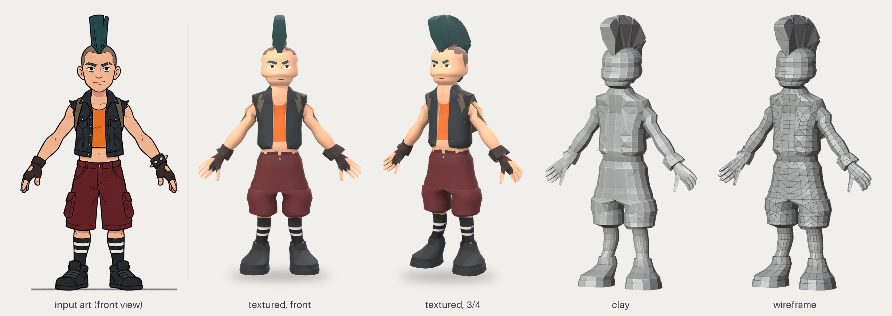
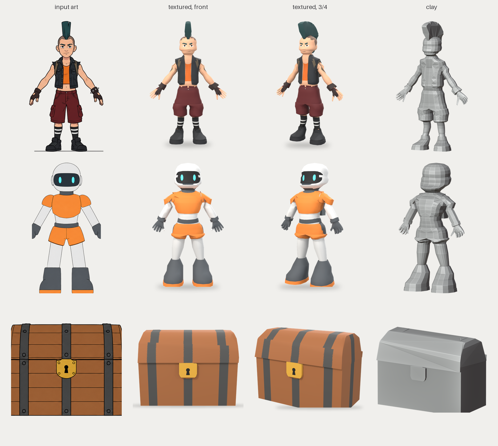
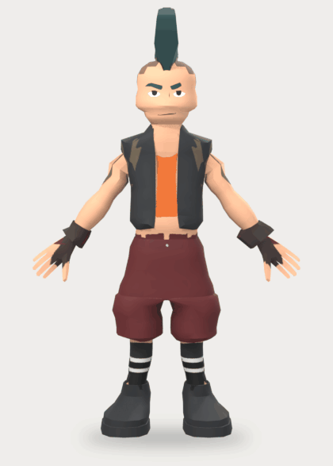
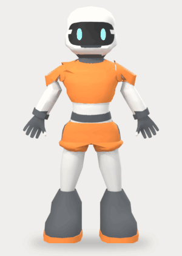
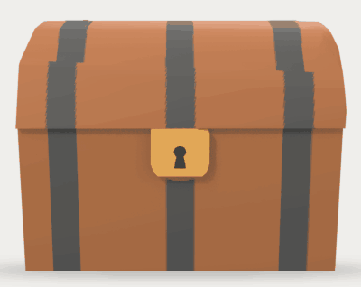
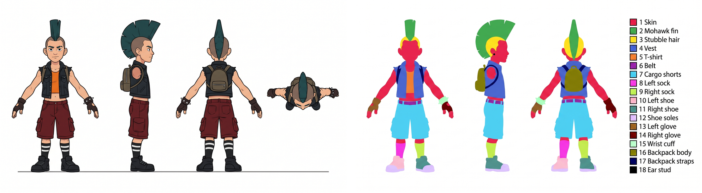
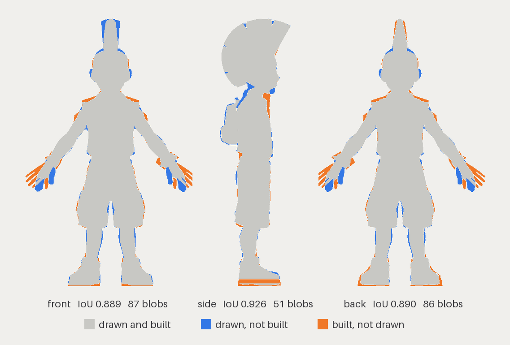
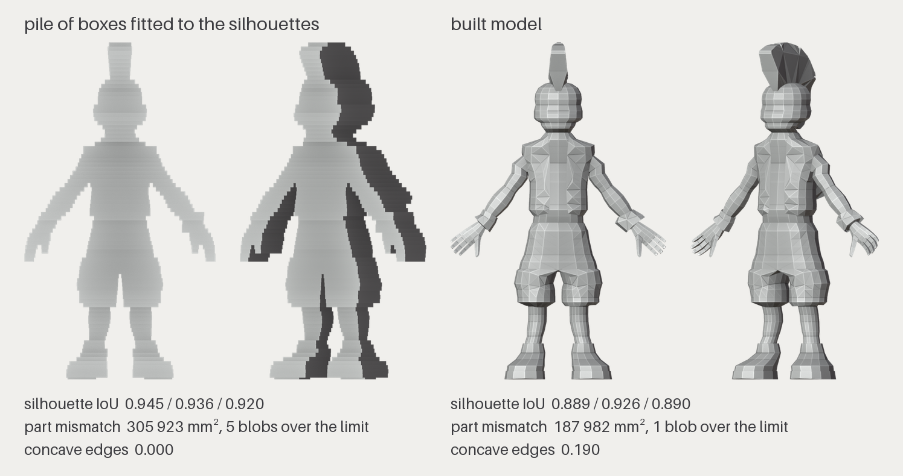

# sketch-to-3d

Builds a low-poly 3D model in Blender from a 2D turnaround sheet, then checks the model against
the drawing with a separate judge.



The input sheets were made with an image generator, the prompts are in `examples/`.

## Examples



<p align="center">
  
  
  
</p>

The models are in [`results/`](results) as `.glb` and `.stl`. GitHub shows STL files in a 3D viewer.

## How it works

The input is two images of the same object:

- `turn.png` - the art, with front, side and back views;
- `parts.png` - the same views, with every part filled with a flat colour from a numbered list
  (`1 skin = #E6194B`, `2 mohawk hair fin = #3CB44B`, ...). Finding the parts is then a colour
  lookup instead of a guess.



The pipeline has four stages:

1. **read** - finds the figures and the floor, sets the scale, labels every pixel with its part
   and measures the figure: neck, waist, knee heights from the front view, depth from the side
   view. Writes `char.json`.
2. **build** - builds the body, clothes, shoes, hair and accessories in Blender from those
   measurements. A prop (`--prop`) is built from the front and side outlines of its parts.
3. **finish** - UVs, a texture painted from the art, the face, an armature, export to GLB, STL
   and FBX.
4. **judge** - opens the saved `.blend`, renders it in the views of the sheet and compares it
   with the drawing. Writes `VERDICT.md`.

## The judge

| check | what it looks at |
|---|---|
| audit | broken geometry: crossing faces, holes, loose vertices, parts floating off the body |
| budget | triangle count |
| accounting | every part from the part map is built or painted into the texture |
| sheet match | silhouette IoU per view, and every region where the model has the wrong part, in mm² |
| surface | dents, needle-thin triangles, symmetry |
| form | whether the surface folds inward anywhere |



Silhouette IoU alone is easy to beat. `scripts/boxes.py` fits a pile of boxes to the same sheet.
The boxes score a higher IoU than the real model in every view, and the judge still fails them:
three parts are missing, there are 232 needle triangles and the surface never folds inward.



| | pile of boxes | built model |
|---|---|---|
| silhouette IoU, front / side / back | 0.945 / 0.936 / 0.920 | 0.889 / 0.926 / 0.890 |
| wrong-part area | 305 923 mm² | 187 982 mm² |
| missing parts | 3 | 0 |
| needle triangles | 232 | 0 |

## Results

| | punk | robot | chest |
|---|---|---|---|
| triangles | 4 438 | 3 774 | 126 |
| silhouette IoU, front / side / back | 0.889 / 0.926 / 0.890 | 0.911 / 0.774 / 0.853 | 0.994 / 0.991 / - |
| wrong-part area | 187 982 mm² | 292 980 mm² | 5 408 mm² |
| verdict | FAIL | FAIL | FAIL |

Full reports are in `results/<name>/VERDICT.md`.

## Running

Needs Blender 5.1 and Python 3.11+.

```
pip install -r requirements.txt
py run.py examples/punk                       # results go to out/punk
py run.py examples/chest --prop --size 0.6    # a prop, size is its height in metres
py run.py examples/punk --only judge          # judge an existing build again
py scripts/boxes.py out/punk out/punk_boxes   # the pile of boxes
py -m pytest -q                               # judge maths, no Blender needed
```

Blender is found from `--blender`, the `BLENDER` environment variable, the default install paths
or `PATH`. On macOS or Linux use `python` instead of `py`.

```
run.py            the whole chain
sketch3d/read     art + part map -> char.json
sketch3d/build    char.json -> char.blend
sketch3d/finish   UVs, textures, armature, export
sketch3d/judge    checks, renders, VERDICT.md
scripts           README images, the pile of boxes
examples/<name>   input images and prompts
results/<name>    models and judge reports
```
